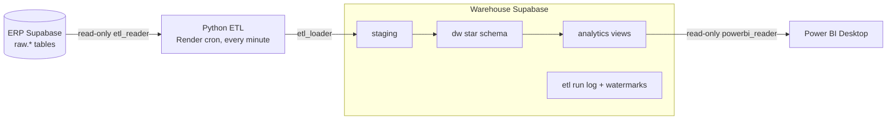

# Supply-chain analytics warehouse

An analytics layer for the Supply Chain ERP app in this repo: a second Supabase PostgreSQL database used as a data warehouse, fed by a Python ETL job that runs every minute, with SQL views built for Power BI.

**Portfolio demonstration on synthetic data.** It is not a UniFirst production system, and it does not connect to Microsoft Dynamics.



## What's here

```
sql/001_warehouse_schema.sql      etl, staging, dw schemas (tables, keys, indexes, dim_date, Unknown members)
sql/002_analytics_views.sql       7 Power BI views + a receipts-per-PO helper
sql/003_warehouse_roles.sql       etl_loader and powerbi_reader logins (no passwords in the file)
sql/source_etl_reader_role.sql    read-only etl_reader login for the SOURCE project
sql/validation_queries.sql        checks to run after each stage
etl/                              the pipeline: extract -> validate -> load staging -> load dw -> log
tests/                            17 tests (unit + end-to-end on a throwaway PostgreSQL)
docs/setup_guide.md               step-by-step setup, browser only
docs/data_model.md                grains, keys, measures, ER diagram, limitations
docs/etl_design.md                extraction strategy, validation rules, recovery, rerun
docs/powerbi_guide.md             connecting Power BI, DAX measures, report pages
../render.yaml                    every-minute schedule on Render
../.github/workflows/             manual ETL button + tests on every pull request
```

## Key decisions

- **Change detection without timestamps.** The source tables have no `updated_at`/`created_at`, so each run reads them in full, in key-ordered batches inside one consistent read-only transaction, and compares a hash of every row. The warehouse then loads incrementally from its own `_changed_at` watermark. See `docs/etl_design.md`.
- **Idempotent everywhere.** Every load is an upsert on the source business key, so reruns and retries never duplicate rows.
- **Safe failure.** Watermarks move in the same transaction as the data, overlapping runs are blocked by an advisory lock, and an empty extract can't wipe the warehouse.
- **Nothing invented.** There are no prices in the source, so there's no revenue. Values are labelled estimates at standard cost, and the limitations are listed in `docs/data_model.md`.

## Run the tests (needs any local PostgreSQL)

```bash
cd analytics-warehouse
pip install -r requirements-dev.txt
TEST_POSTGRES_URL=postgresql://postgres@localhost:5432/postgres python -m pytest -v
```

GitHub runs the same tests automatically on every pull request (`.github/workflows/warehouse-tests.yml`).
