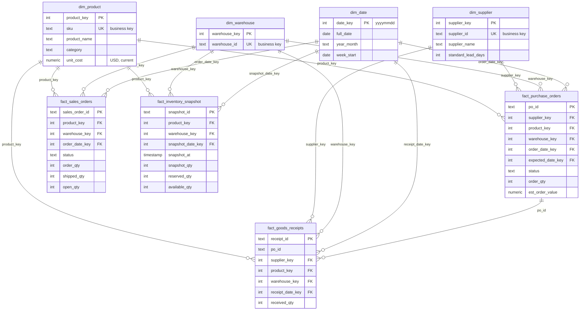

# Warehouse data model

Built from the real source schema (checked 2026-10-26, six `raw` tables). Nothing here is invented: where the source lacks something, the limitation is written down instead of filled in.

## Layers

| Schema | What it holds | Who writes it |
|---|---|---|
| `staging` | One table per source table, same columns and types, plus ETL metadata columns starting with `_` | ETL |
| `dw` | Star schema: 4 dimensions, 4 facts | ETL |
| `analytics` | Views for Power BI | SQL only (no tables) |
| `etl` | Run log, watermarks, rejected records | ETL |

## Fact tables and their grain

Every source order has exactly **one SKU** (there are no line tables), so "one row per order" is also "one row per order line".

| Fact | Grain (one row per…) | Business key | Measures (unit) |
|---|---|---|---|
| `fact_purchase_orders` | purchase order | `po_id` | `order_qty` (units), `est_order_value` (USD, estimate, see below) |
| `fact_goods_receipts` | goods receipt (one delivery event) | `receipt_id` | `received_qty` (units) |
| `fact_sales_orders` | sales order | `sales_order_id` | `order_qty`, `shipped_qty`, `open_qty` (units) |
| `fact_inventory_snapshot` | inventory count: product × warehouse × `snapshot_at` | `snapshot_id` | `snapshot_qty`, `reserved_qty`, `available_qty` (units) |

Grains are never mixed. Receipts are linked to POs through `po_id`, and the views always **sum receipts per PO first** and only then join to the PO, so order quantities and values are never repeated once per receipt.

Inventory snapshots are history: a new count is a new row, and old counts are kept.

## Dimensions

| Dimension | Surrogate key | Business key | Built from | Type |
|---|---|---|---|---|
| `dim_product` | `product_key` | `sku` | `raw.products` | SCD type 1 (overwrite) |
| `dim_supplier` | `supplier_key` | `supplier_id` | `raw.suppliers` | SCD type 1 |
| `dim_warehouse` | `warehouse_key` | `warehouse_id` | distinct codes on POs, receipts, sales orders, snapshots | insert-only |
| `dim_date` | `date_key` (yyyymmdd) | `full_date` | generated 2024–2028 | static |

**Unknown member.** Every dimension has a row with key `0` ("Unknown"). A fact whose SKU, supplier or warehouse is missing, or not loaded yet, points to `0` instead of failing. When the real dimension row arrives later, the next run moves the fact to the real key (the "late-arriving dimension" fix-up in `etl/load_dw.py`). `analytics.vw_data_quality` counts facts still on `0`.

**Surrogate vs business keys.** Facts join to dimensions on the integer surrogate keys (small and fast in Power BI). Every table keeps the original source ID too (`sku`, `po_id`…), so any warehouse row can be traced back to its source row.

## Relationships (Power BI uses the same ones)

- `dim_product` 1 → many each fact (`product_key`)
- `dim_warehouse` 1 → many each fact (`warehouse_key`)
- `dim_supplier` 1 → many `fact_purchase_orders`, `fact_goods_receipts` (a receipt's supplier is its PO's supplier)
- `dim_date` 1 → many on `order_date_key`, `receipt_date_key`, `snapshot_date_key`; `expected_date_key` is a second, inactive date role
- `fact_goods_receipts.po_id` → `fact_purchase_orders.po_id` is a *degenerate* link: use it through `analytics.vw_po_receipt_totals`, not as a direct many-to-many join

## ER diagram

## Assumptions and limitations (from the source data)

1. **No change timestamps in the source.** No table has `created_at`/`updated_at`. See `etl_design.md` for how the ETL detects changes anyway.
2. **No prices on orders.** POs and sales orders have quantities only. `est_order_value` = `order_qty × current unit_cost`, labelled as an estimate. There is **no sales revenue** anywhere; the sales view shows `est_cost_value` (at cost), not sales amount.
3. **Currency is assumed USD.** The source does not store a currency.
4. **unit_cost is current, not historical.** Dimensions are SCD type 1, so if a cost changes, past estimated values change too. Type 2 history would need a cost-effective-date the source does not have.
5. **No warehouse master.** `dim_warehouse` only has the code. Names, regions and capacities don't exist in the source, so none were made up.
6. **Receipts have a date, not a time**, and snapshots are taken at 08:00. A receipt on the same day as a count is treated as already counted, which is the same rule as the source view `reporting.vw_inventory_reconciliation`.
7. **No ship dates.** Sales orders have `shipped_qty` but not when it shipped, so calculated on-hand inventory cannot subtract shipments and can overstate stock between counts.
8. **No reorder points or safety stock.** Low-stock alerts need thresholds the source doesn't have. The inventory view only flags rules that need no threshold: *No available stock* and *Over-reserved*.
9. **One PO is one line.** If the source later adds PO line tables, the PO fact grain must change to the line.
